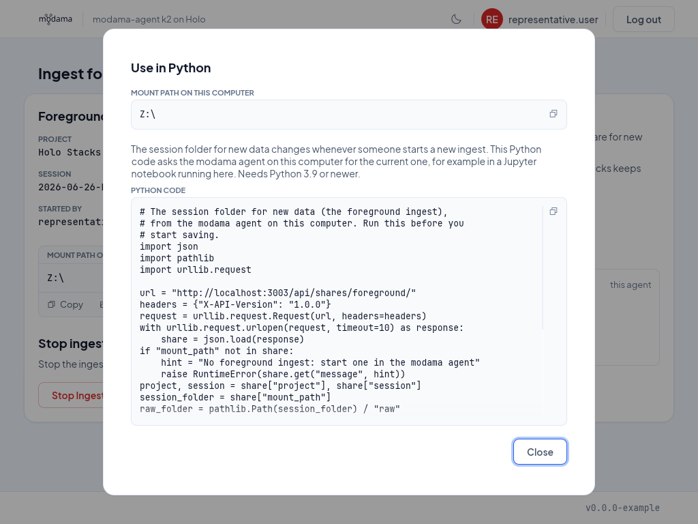

# `modama-agent` - getting data into `modama`

To ingest data into `modama`, we provide a small software called `modama-agent`.
Using `modama-agent`, you can create a networked session folder, which we call
an "ingest share". 

## How to create an ingest share

- Step 1: start the `modama-agent` GUI


- Step 2: log in


- Step 3: click "Create ingest share" button

TODO: describe how to choose a project.


- Step 4: enter session details or select existing session

TODO: describe the choice between a new and an existing session.


- Step 5: confirm

TODO: describe the confirmation step.

Now the ingest share should be available, either as a mapped network drive,
or as a mounted network filesystem under Linux.


## How to upload data to the ingest share

The ingest share should automatically open on all data-producing systems. On
Windows, it will be mapped as a network drive (for example `Z:\`). Simply save
your data on this network drive, or copy/drag is there, and it will be stored
in the data management.

## Automation: how to get the current session folder?

If you would like to integrate data management into your automation, for example
into an acquisition script or notebook, this is easily possible! `modama-agent`
provides a local HTTP API, which you can query for the current
session folder. We call this the "foreground ingest". The GUI has ready-made
Python code for this: on the ingest page, click "Use in Python" below the mount
path:



The code looks like this:

```python
# The session folder for new data (the foreground ingest),
# from the modama agent on this computer. Run this before you
# start saving.
import json
import pathlib
import urllib.request

url = "http://localhost:3003/api/shares/foreground/"
headers = {"X-API-Version": "1.0.0"}
request = urllib.request.Request(url, headers=headers)
with urllib.request.urlopen(request, timeout=10) as response:
    share = json.load(response)
if "mount_path" not in share:
    hint = "No foreground ingest: start one in the modama agent"
    raise RuntimeError(share.get("message", hint))
project, session = share["project"], share["session"]
session_folder = share["mount_path"]
raw_folder = pathlib.Path(session_folder) / "raw"


# A subfolder of the raw folder that doesn't exist yet, numbered
# after the highest one there: scan_0001, scan_0002, ...
# With full_path=False, only its name. Create it yourself.
def free_subfolder(prefix="scan_", digits=4, full_path=True):
    numbers = [0]
    for path in raw_folder.iterdir():
        rest = path.name.removeprefix(prefix)
        if path.name.startswith(prefix) and rest.isdecimal():
            numbers.append(int(rest))
    name = f"{prefix}{max(numbers) + 1:0{digits}}"
    return raw_folder / name if full_path else name
```

The code needs Python 3.9 or newer. `project` and `session` are the names of the
project and the session that the data goes to.

Run the code again after a new ingest was started: the session folder is then a
different one, and the old path no longer works.

The `session_folder` is valid only on the computer where you ran this snippet,
different computers have their own mount paths.

## Automation: how to get a new folder for each measurement?

Raw data goes into the `raw_folder`, the `raw` folder inside the session folder.
If each measurement should get its own subfolder there, use `free_subfolder()`
from the snippet above. It looks into the raw folder and gives you the next
numbered subfolder:

```python
target = free_subfolder()  # .../raw/scan_0001
target.mkdir()
# save your data into target
```

`free_subfolder()` only picks the name, so create the folder yourself, as in the
example. Once it exists, the next call gives `scan_0002`. The number is always
one higher than the highest one in the raw folder, so a number is not used
again after you remove an older subfolder.

You can change the name and what you get back:

- `free_subfolder("dark_")` gives `dark_0001`: each prefix has its own numbers.
- `free_subfolder(digits=6)` gives `scan_000001`.
- `free_subfolder(full_path=False)` gives only the name, `"scan_0001"`. Use this
  to pass the name on to a program on another computer, which has its own path
  to the raw folder.
